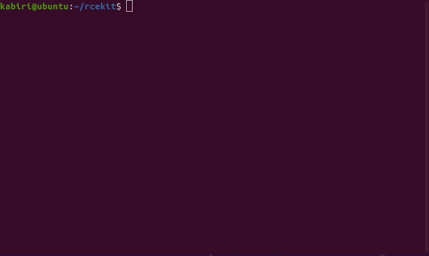
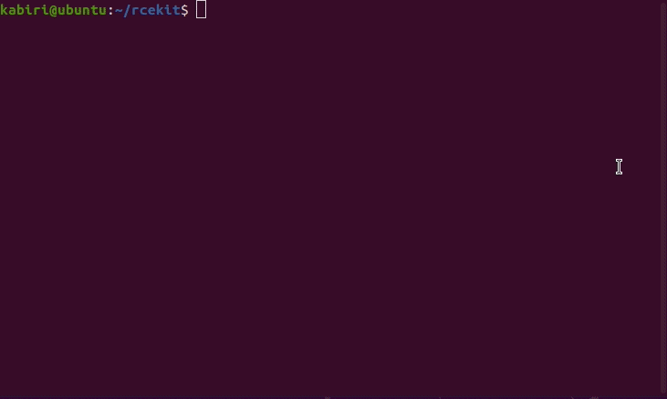
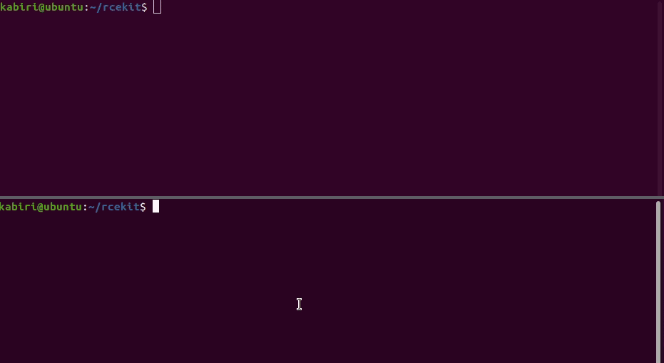
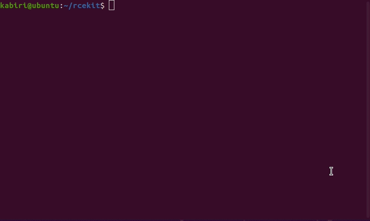

# RCEKit

**`executed` means the target executed the input. `negative` means the probes reached it.**

**Version 3.1.2** · MIT · Python 3.8+ · zero third-party dependencies

RCEKit is an **RCE detection &amp; confirmation toolkit** for authorised penetration
testing, red teaming and security research. Point it at a target you are allowed
to test — a URL or a captured HTTP request — and every finding comes back with
the tier it earned.

Every `executed` rests on a value RCEKit generated at random for that probe and
that reflection cannot produce. It comes back through one of 3 channels: a
computed result **present in the response** and absent from a payload-free
control; an **out-of-band callback** carrying a token only the target ever held;
or a value the target stored and RCEKit **fetched back** in a second request —
the token `file` has it write to a path it serves, the product `write`'s
one-liner computes when the target interprets the file it stored. Weaker signals
keep their own tiers and are never promoted into it. And a run that could not
test something never reports it as clean.

---

## Proof, not "maybe"

RCEKit confirms RCE through **multiple methods** under one CLI. Below it is pointed
at real production software — publicly-documented CVEs, and builds that
demonstrate a method without reproducing one — with every verdict differenced
against a payload-free control:

| Target | Advisory | RCE class | `--methods` | Verdict | Bench case | Recording |
|---|---|---|---|---|---|---|
| Webmin 1.910 | CVE-2019-15107 | OS command injection (results-based) | `reflected` | **`executed`** | yes | GIF |
| Apache Struts2 | S2-001 | Expression injection (OGNL) | `eval` | **`executed`** | yes | GIF |
| Apache Solr 8.11.0 (Log4j 2.14.1) | CVE-2021-44228 | Expression-lookup (Log4Shell/JNDI) | `lookup` | `lookup-sink` | yes | GIF |
| Webmin 1.910 | CVE-2019-15107 | Blind command injection (no output) | `time` | `timing-sink` | as a control | GIF |
| Webmin 1.910 | CVE-2019-15107 | OS command injection (self-OOB read-back) | `file` | **`executed`** | yes | — |
| OpenTSDB 2.4.1 | CVE-2023-25826 | Blind command injection (gnuplot) | `oob` | **`executed`** | yes | — |
| OpenTSDB 2.4.1 | CVE-2023-25826 | Blind command injection (gnuplot) | `time` | `timing-sink` | as a control | — |
| Apache HugeGraph 1.2.0 | — | Expression injection (Gremlin/Groovy) | `eval` | **`executed`** | yes | — |
| Apache HugeGraph 1.2.0 | — | OS command injection | `reflected` | **`executed`** | yes | — |
| Spring Boot on fastjson 1.2.83 | — | Deserialization sink | `deser` | `deserialization-sink` | yes | — |
| Apache Tomcat 8.5.19 | CVE-2017-12615 | Write primitive (PUT a JSP) | `write` | **`executed`** | yes | — |

3 of those columns say how much weight the row carries, and they are the ones
worth reading before the rest.

**Verdict** is what the run reported against that build. Measured, not what the
method could reach in principle.

**Bench case** says whether [`tests/bench/`](tests/bench/) reproduces the row —
bringing the target up under Docker and checking the verdict **and** its negative
control. All 11 rows do; `python tests/bench/runner.py --all` was last green at
**3.0.1** (2026-10-01), 10/10 cases in 55m48s. That is a point-in-time claim:
the benchmark runs on a cadence, not on every change.

The controls are not in this table and two of them are the point. On a Webmin
1.910 and an OpenTSDB 2.4.1 that are genuinely vulnerable, `time` reaches its
own proven tier and still does not reach `executed` — a ceiling holding against
real software rather than against a fixture. Those two are the rows reading *as
a control* above. The full 10, controls included, are in
[`tests/bench/README.md`](tests/bench/README.md#status).

**Advisory** is empty where the verdict does not depend on the patch. Both
HugeGraph rows and the fastjson row are `—` deliberately: HugeGraph 1.3.0 answers
the arithmetic exactly as 1.2.0 does — its Gremlin API evaluates Groovy
unauthenticated by design, which was checked by pulling the patched image and
running it — and fastjson resolving an `Inet4Address` is documented autoType
behaviour. Those rows prove a **method** against real software, which is worth
recording; calling them CVE reproductions would be the overclaim this table
exists to avoid.

Each control is the row's real test. Struts2 probed with `reflected` comes back
`negative`, because S2-001 re-evaluates OGNL and there is no shell behind it.
Webmin's `time` signal is held at `timing-sink` on a target where it happens to
be right. And Solr probed with `oob` comes back `negative` **although it is
exploitable** -- `oob` builds shell commands and a `${jndi:...}` sink runs none
of them, which is the gap `lookup` exists to close, measured rather than
asserted.

The Log4Shell row says `lookup-sink`, not `executed`: what the callback proves
is that the sink resolved a URI RCEKit chose. Reaching RCE needs a server that
answers the lookup with a loadable class, and at the default risk tier only
`jndi:dns://` goes out -- a name lookup, with no connection past it for such a
server to answer on.

<details open>
<summary><b><code>reflected</code> — OS command injection, Webmin CVE-2019-15107 → <code>executed</code></b></summary>

<br>



</details>

<details>
<summary><b><code>eval</code> — OGNL expression injection, Apache Struts2 S2-001 → <code>executed</code></b></summary>

<br>



</details>

<details>
<summary><b>out-of-band — blind Log4Shell (CVE-2021-44228) via a DNS callback → <code>lookup-sink</code></b></summary>

<br>



</details>

<details>
<summary><b><code>time</code> — blind command injection, Webmin CVE-2019-15107 → <code>timing-sink</code></b></summary>

<br>



</details>

---

## Quick start

RCEKit has **two supported shapes**, and neither is a fallback for the other.

**Install it** — `pipx` keeps the CLI in its own environment, which is what you
want for a tool rather than a library:

```bash
pipx install rcekit          # or: pip install rcekit
rcekit --doctor              # confirms the corpus it will run with
```

**Or take just the one file.** The payload corpus is built into the module, so
`rcekit.py` runs on its own with nothing beside it — no install step, no
site-packages, nothing to leave behind. On a client jump box, an air-gapped
host, or anywhere `pip install` is not an option:

```bash
curl -O https://raw.githubusercontent.com/kabiri-labs/rcekit/main/rcekit.py
python rcekit.py --doctor    # same corpus, same check, zero installation
```

Both run the same code and report the same verdicts. Working from a checkout is
the third way, and needs no install either:

```bash
git clone https://github.com/kabiri-labs/rcekit.git
cd rcekit                    # Python 3.8+, standard library only
```

Put a `FUZZ` marker where your input lands (or select a parameter with `-p` when
using a captured request), and ask RCEKit to prove RCE:

```bash
rcekit --acknowledge-consent \
  --verify-url "https://target.example/lookup?host=FUZZ" \
  --methods reflected,eval
```

```
[detect] methods: reflected, eval
[detect] sent 1430 probes (1430 result(s)): executed=17, negative=1413

[detect] EXECUTED (17):
  [reflected/unix/raw] | awk 'BEGIN{print "RKDXCXU" 206334+786088 "RKLMVXZ"}'
      (target computed 'RKDXCXU992422RKLMVXZ' (random operands, absent from control))
```

**That is 1430 requests against this target.** With no `--environments`, RCEKit
sweeps every sink dialect it knows — POSIX, `cmd.exe`, PowerShell, and the
language runtimes that reach a shell — because which one is behind the parameter
is the thing you do not know yet. 17 of them computed the value, which is one
sink answering in seventeen dialects, not seventeen findings.

The target moves the number: at the default `--confirm-depth first`, a carrier
stops once it confirms, so a sink that answers sends **fewer** probes than one
that never does. The same command against an endpoint that only echoes sent
1684.

Narrow it when you already know something. Against the same target, the same
command plus `--environments unix` sends 177 requests; adding `--contexts raw`
as well sends 32.

Every probe count in this quick start was measured at **3.0.0**, and like the
benchmark's they are point-in-time rather than constants. 3.0.1 retired a probe
shape, which took a measured 44 requests per point off a comparable sink —
without costing a single confirmation, which is why the `executed` counts are
the figures least likely to have moved.

**`--max-payloads` means two different things, and both will surprise you once.**

On a single point — a `--verify-url`, or `-r` without `--auto-params` — it is
one allowance **shared by every method you selected**. `--methods
reflected,deser --max-payloads 5` sends 5 probes in total, and `reflected` can
spend all five: `deser` then never runs, and the run reports nothing about
deserialization because it never asked. That is the shape to watch, because a
budget set for politeness quietly becomes a coverage gap.

Under `--auto-params` it is the opposite — a budget *per injection point, per
question*, where execution, lookup and deserialization are three questions, and
each point's payload-free control sits outside it. Measured: `--max-payloads 5`
across 3 points and 2 questions sent 30 probes, not 5.

So read the cost line. It prints before any traffic and names the multiplier it
is applying:

```
[detect] cost: 3 points x ~10 probes (capped by --max-payloads 5 per question,
         2 question(s) asked) = at least 36 requests (each point carries its
         own payload-free control)
```

### From a captured request — the shape most real targets have

A `--verify-url` carries a URL and nothing else. Most sinks worth testing sit
behind a POST with a session cookie, a content type and a body, and RCEKit takes
that request whole: save it from your proxy or your browser's devtools and name
the field to inject into.

```bash
rcekit --acknowledge-consent \
  -r search.req -p q \
  --methods reflected,eval
```

```
[detect] EXECUTED (17):
  [reflected/unix/raw] | awk 'BEGIN{print "RKXJTON" 570247+922635 "RKJCVJT"}'
      (target computed 'RKXJTON1492882RKJCVJT' (random operands, absent from control))
```

Same corpus, so the same scale as above — what changes is that the session
cookie, the content type and the body go with every probe.

The method, path, headers, body and cookies are reused as captured, and each
value is encoded for the context it lands in — a JSON leaf, a form field and a
cookie are not escaped the same way, and inside an XML body an attribute value
and a CDATA section are not either. Drop `-p` and mark the spot with `FUZZ` or
`*` instead, if you prefer.

### Everything the tool has

Two things are only reachable from a captured request: **injection-point
enumeration** (`--auto-params`), and any sink that needs a session. So the
fullest run RCEKit can make starts from `-r`, not from a URL — which is worth
knowing before concluding a target is clean.

```bash
rcekit --acknowledge-consent \
  -r search.req --auto-params all --point-order thorough \
  --methods reflected,eval,time,oob,lookup,deser,boolean \
  --oob-host oob.yourdomain.example --listen-dns-port 53 \
  --verify-active-risk stateful --probe-depth full \
  --detect-json findings.json
```

That is **7 of the 9 methods**. The two left out are the ones that need a path
only you can supply: `file` wants somewhere writable the target also serves
(`--file-write-path` + `--file-read-url`), and `write` wants the URL your own
upload lands at (`--write-url-template`). Both are below.

```
[verify] loaded request from search.req: enumerating 4 injection point(s)
[detect] enumerating 4 injection point(s) x 3 method(s)
[detect] cost: 4 points x ~1739 probes = at least 6964 requests
[detect]   body param 'q': executed (1544 probes)  <-- EXECUTED
[detect] sent 6371 probes: executed=446, negative=5925
```

What each flag opens up:

| | |
|---|---|
| `--auto-params all` | every query value, JSON leaf, XML element, attribute and CDATA section, form field, multipart part, cookie and header, instead of one named field |
| `--point-order thorough` | every non-hop-by-hop header, not just the high-yield ones |
| `--methods ...,lookup,deser` | expression-lookup and deserialization sinks, which the shell-shaped methods cannot reach |
| `--oob-host` | a callback host for the blind methods. An IP the target can reach serves `oob`; `lookup` and `deser`'s gadget can only put a token in a DNS label, so both need a domain delegated to you, and port 53 needs root |
| `--verify-active-risk stateful` | the top rung — adds the probe shapes that make the target fetch from an address RCEKit did not choose |
| `--probe-depth full` | every break-out shape per sink, not the cheap ones only |
| `--detect-json` | the same verdicts as machine-readable JSON |

**This is a lot of requests.** The cost line prints before anything fires, and
`--max-points` / `--max-payloads` bound it. Run it against an instance you are
allowed to break: `--verify-active-risk stateful` is the tier for a disposable
target, not for production.

No external infrastructure, no config file.

### When nothing comes back

The most common way to call a target clean when it is not: `reflected` and
`eval` need the computed value rendered somewhere, and a sink that returns no
output has nowhere to render it. A `negative` from those two is not an answer
about the sink, only about the channel.

Two methods still reach **`executed`** there, and which one you can use depends
on what you have:

```bash
# The target can reach something of yours. An address is enough: `oob` carries
# the token in a URL path, so the HTTP channel alone can reach `executed`.
rcekit --acknowledge-consent \
  --verify-url "https://target.example/render?q=FUZZ" \
  --methods oob --oob-host 203.0.113.9 \
  --verify-active-risk intrusive
```

Give it a **delegated name** and `--listen-dns-port 53` instead when you have
them, and the DNS shapes come alive too — those often cross egress filtering
that blocks outbound HTTP. They cannot work off an address: a resolver reaches
the authority for a name on port 53 only, and RCEKit says so rather than sending
probes that silently never fire. The benchmark's OpenTSDB case runs the plain
address form and reaches `executed`.

```bash
# No egress at all — but something writable you can also read back.
# Writes a random token, fetches it, and prints a cleanup line per finding.
rcekit --acknowledge-consent \
  -r search.req -p q \
  --methods file \
  --file-write-path /var/www/html/uploads \
  --file-read-url "https://target.example/uploads/{name}" \
  --verify-active-risk stateful
```

The read-back does not have to be a web root. `--file-read-url` takes `{name}`
for a handler that wants a filename, and `{path}` or `{path_enc}` for one that
takes the whole server-side path — so a writable `/tmp` plus an LFI parameter,
a download handler or an export endpoint is enough.

With neither, `--methods time` still measures a controlled delay series — but it
reports `timing-sink`, which proves the target honoured a delay and not that a
shell ran. [Blind targets](docs/guide.md#blind-targets) and
[No-egress targets](docs/guide.md#no-egress-targets) work each of these through.

### When your own request stores the file

An upload, or a `PUT` the server accepts. Nothing in the response is computed,
so `reflected` and `eval` report `negative` against a target that is fully
exploitable. `write` inverts the question: it stores a one-liner that *computes*
a product, fetches the file back, and reads which of three things happened —
the product (`executed`), the source verbatim (`file-write`, an arbitrary write
that is served but not interpreted), or neither.

```bash
rcekit --acknowledge-consent \
  --verify-url "https://target.example/probe.jsp/" \
  --verify-method PUT --verify-data FUZZ --verify-body-location raw \
  --methods write --write-url-template "https://target.example/probe.jsp" \
  --verify-active-risk stateful
```

That is the CVE-2017-12615 shape, and it is one of the benchmark's cases.
[Upload and write-primitive targets](docs/guide.md#upload-and-write-primitive-targets)
covers the others.

**Don't take the GIFs on trust** — [reproduce them yourself](docs/verify-it-yourself.md)
against dockerised Webmin and Struts2 targets in about five minutes.

**Next:** the [**field guide**](docs/guide.md) walks the real situations — captured
requests, WAFs, filtered separators, quoted sinks, blind and no-egress targets —
one worked example each.

---

## What a verdict means

Finding an RCE *candidate* is easy. Reporting one that survives someone else's
retest is the hard part, and it fails in two directions: a "possibly vulnerable"
that turns out to be reflection, and a "not vulnerable" from a run that never
actually tested anything.

RCEKit answers with **twelve verdicts that are never collapsed into each
other**. Every one of them is named for **what the target did**, not for how
sure RCEKit is:

| Verdict | What it asserts |
|---|---|
| **`executed`** | The target executed the input. It returned a value it could not produce otherwise — computed from operands random to that probe — and that value is absent from a payload-free control. |
| **`timing-sink`** | The target honoured a delay RCEKit injected: response time tracked a randomised `0/N/2N` series with the request index modelled out. Proven. What waited is not shown — a sandbox implementing `sleep` answers the same way — so it is not execution. |
| **`file-write`** | The target stored a file at a path RCEKit chose, and served it back uninterpreted. Arbitrary file write, proven by reading it back. A real finding, and not RCE. |
| **`evaluation-sink`** | An evaluator consumed the input and partitioned the response on it, through randomised true/false predicates anchored either side. Proven. *Which* evaluator is not shown, and that is the whole limit. |
| **`deserialization-sink`** | The target reconstructed an attacker-supplied object graph. Proven, but about a *different property*: reaching RCE from there depends on classpath gadgets, so it is never called RCE. |
| **`lookup-sink`** | The target resolved a URI RCEKit handed it — a `${jndi:…}` expression reached a lookup, proven on a callback carrying a token only that probe held. It is a sink, not execution: reaching RCE from there needs a server answering with a loadable class. |
| **`needs-review`** | A real signal that is not proof on its own — the parser fingerprint `deser` reads without a listener. The one verdict here that is genuinely a candidate. |
| **`inconclusive`** | Nothing here can be attributed to execution. Either the evidence appeared and the payload-free control carried it too, or the run never gathered it — a response channel too unsteady to carry an answer, or a measurement `--max-payloads` could not afford to finish. It outranks `negative`, because a run that did not look is not a run that found nothing. |
| **`negative`** | Probes were built, reached the target, and found nothing. |
| **`blocked`** | A filter refused the payload where the payload-free control got through, so the sink never saw it. The probes reached something; it was not the target. |
| **`error`** | Nothing reached the target. |
| **`nothing-tested`** | No probes were built at all. |

The moment `executed` and `maybe` blur, `executed` stops meaning anything — so
nothing is ever promoted upward. A timing regression stays `timing-sink` however
clean the slope. A deserialization callback stays `deserialization-sink` however
certain you are that the classpath is exploitable. A response shape that tracks a
predicate stays `evaluation-sink` however cleanly it partitions: measured against
a sandboxed `eval` sink and against a plain SQLite comparison, that oracle
produced the same clean differential in 40 runs each, and only one of those two
is RCE.

**Nothing is rounded down either**, which is the half that used to be wrong.
Three of the rows above — `timing-sink`, `file-write`, `evaluation-sink` — were
reported as `needs-review` until 3.0.0. Each is a settled measurement, so
`needs-review` was RCEKit declaring itself unsure of something it had proven; a
`file-write` finding printed the words "ARBITRARY FILE WRITE confirmed" under a
verdict that said the opposite. A verdict now says what happened and stops
there.

### The other half: a run that tested nothing is never clean

The last three rows are the ones other tools do not have, and they matter more
than they look. A scanner that could not reach the target, that built no probes
because your flags excluded every one of them, or whose every payload was
refused by a WAF, has learned **nothing** about the target — and printing
`negative` there is a lie that reads exactly like safety.

So `error` and `nothing-tested` are first-class verdicts, the run exits non-zero,
and RCEKit says which of them happened and why:

```
[!] No probes were built, so NOTHING WAS TESTED — this is not a negative result.
[!] None of the selected methods (reflected, file) apply to environment(s): sql.
```

It fires wherever a run can quietly become empty: a method that does not apply to
the selected environments, a `--sink-shape` rung the chosen shell has no syntax
for, a `--bridges` selection entirely held back by the safety ceiling, a request
body that broke delivery before it arrived.

A run that was only *partly* blinded gets the same treatment one level down. If
you asked for a second-order oracle and the observed endpoint never answered, the
probe verdicts still stand — but the run tells you they were decided without ever
reading the channel you pointed it at, rather than letting them pass for a
second-order negative.

---

## What it confirms

One CLI, one `--methods` flag, covering the main paths to RCE:

| RCE class | `--methods` | How RCEKit proves it |
|-----------|-------------|----------------------|
| **OS command injection** | `reflected` | Makes the shell compute `$((a+b))` on random operands and collapse `$(echo TAG)`; confirms the *result*, never the literal expression. Written in the sink's own dialect — POSIX, `cmd.exe` or PowerShell. |
| **Code / expression injection** — SSTI, SpEL, OGNL, Groovy, `eval()` (CWE-94) | `eval` | Injects `a*b` in every common template syntax (`${…}` `{{…}}` `#{…}` `%{…}` `<%=…%>` `@(…)`, bare); confirms the **product** appears while the literal `a*b` does not. |
| **Blind command injection** (no output) | `time` | Fires a controlled `0/N/2N` delay series and confirms the response time tracks the delay **linearly**; reported `timing-sink` — proven, and not execution: what waited is not shown. |
| **Internal / no-egress** targets | `file` | Writes a random token and fetches it back through *any* read-back path — a web root, an LFI parameter, a download or export handler, a `/tmp`-backed preview. Proves execution **plus** a write primitive, with no external listener. |
| **Upload / write primitive** — PUT-a-JSP, unchecked upload (CWE-434) | `write` | Writes a one-liner that *computes* a product through your own upload request, then fetches the file: the product is `executed` RCE, the source coming back verbatim is `file-write` — arbitrary file write, served but not interpreted. |
| **Deserialization sinks** — fastjson, shiro, weblogic (CWE-502) | `deser` | Proves the endpoint **deserializes** attacker data, via a non-executing DNS gadget or an error-shape differential. Reported as `deserialization-sink`, **never** as RCE. |
| **Blind / out-of-band** — exfil, async | `oob` | Built-in HTTP/DNS listener receives callbacks and correlates each to the exact payload; every probe carries its own token. |
| **Predicate sinks with nothing rendered** — MongoDB `$where`, filter and rule expressions | `boolean` | Fires randomised true/false comparisons on random operands and reads the *shape* of the response, anchored either side so a target that merely drifts cannot answer in its place. Reported `evaluation-sink`: proven that an evaluator consumed the input, and no more — a query engine comparing two numbers produces the same differential. |
| **Expression-lookup sinks** — Log4Shell/JNDI | `lookup` | The sink resolves a `${jndi:…}` URI instead of running a command, so `oob`'s shell probes reach nothing. Proves it on the callback alone and reports `lookup-sink`, **never** `executed`. Only `jndi:dns://` is sent — a name lookup and nothing else — so what is proven is the lookup, not a gadget chain. |

Three things widen where those methods can reach, without changing what any of
them will call `executed`:

- **Second-order execution** (`--observe-url`) — when the payload lands on one
  request and runs on another: stored SSTI rendered on a profile page, a payload
  written to a log a template engine later renders, a queued job. The observed
  endpoint is differenced against a snapshot taken *before* any probe was sent.
- **Query-language bridges** (`--bridges`) — `COPY … FROM PROGRAM`,
  `xp_cmdshell`, `expect://`. A bridge is a carrier, not an oracle: it wraps the
  command the methods already build, so the same tiers apply through it.
- **Injection-point enumeration** (`-p all`) — query, JSON leaves, XML and SOAP
  elements, attributes and CDATA sections, form fields, multipart parts, cookies,
  headers and path segments, each encoded for where it lands, with the probe cost
  printed before anything fires. A GraphQL body is ordered by what can actually
  confirm: the `variables` a resolver reads before the operation document itself.
  An XML body is spliced at the value's offsets rather than re-emitted, so a
  whitespace-significant envelope survives and a DOCTYPE in an XXE capture is
  never resolved by RCEKit itself; a *signed* envelope is not probed, and the run
  says so instead of reporting zero points.

Mix methods freely: `--methods reflected,eval,time` runs all three and reports each
tier separately.

> **Honest scope.** RCEKit confirms RCE that is reachable by **injecting into a
> request** and interpreted by a shell or an evaluator. It does **not** cover
> memory-corruption bugs (buffer overflow, UAF) or argument injection into a
> no-shell `argv` array — those are different problems. **Deserialization gadget
> chains stay out of scope too**: `--methods deser` proves an endpoint
> *deserializes* attacker data and says so in its own tier, but which gadget (if
> any) turns that into execution depends on the target's classpath, and RCEKit
> does not claim to know. It aims to be excellent at the injection-driven RCE
> classes above rather than mediocre at everything.

---

## How RCEKit compares

The other tools in this space are built to get you **in**. RCEKit is built so the
finding **survives someone else's scrutiny** — the client's retest, the triage
queue, the report review. That difference shows up three times.

### 1. One injection point, every class, one run

You rarely know the class before you test. Covering an unknown sink with
single-class tools means running each in turn and rebuilding the request for each
one:

| Can confirm | RCEKit | [commix](https://github.com/commixproject/commix) | [SSTImap](https://github.com/vladko312/SSTImap) | [Nuclei](https://github.com/projectdiscovery/nuclei) |
|---|---|---|---|---|
| OS command injection — `reflected` | ✅ | ✅ *(its whole scope)* | — | per template |
| Expression injection / SSTI — `eval` | ✅ | via its eval-based technique | ✅ *(its whole scope)* | per template |
| Blind — timing — `time` | ✅ *as a separate tier* | ✅ | ✅ | — |
| Blind — out-of-band — `oob` | ✅ *built-in listener* | — | — | via [interactsh](https://github.com/projectdiscovery/interactsh) |
| Expression-lookup — Log4Shell/JNDI — `lookup` | ✅ *own tier, never called RCE* | — | — | per template |
| No-egress — write &amp; fetch back — `file` | ✅ *any read-back path* | ✅ *(web root)* | — | — |
| `cmd.exe` and PowerShell sinks | ✅ *per-dialect probes* | ✅ *(cmd)* | — | per template |
| Upload → write-then-execute — `write` | ✅ *write vs. execute, separate tiers* | — | — | per template |
| Predicate sink, nothing rendered — `boolean` | ✅ *response-shape differential, own tier, never RCE* | — | — | — |
| Second-order — lands here, runs there | ✅ | — | — | — |
| Query-language bridge to the OS | ✅ | — | — | per template |
| Deserialization sink — `deser` | ✅ *own tier, never called RCE* | — | — | per template |
| **All of the above, one CLI, one run** | **✅** | — | — | — |

<sub>Coverage per each project's own documented technique list. SSTImap is the
maintained successor to <a href="https://github.com/epinna/tplmap">tplmap</a>,
which its author has marked unmaintained.</sub>

```bash
# Command injection, expression injection and blind timing against the same
# parameter, in one pass, with zero infrastructure
python rcekit.py --acknowledge-consent -r request.txt -p host --methods reflected,eval,time
```

### 2. It argues with its own results

A tool reports what it found. RCEKit also reports **what it refused to believe** —
`inconclusive` is a verdict of its own, for anything it cannot attribute to
execution: evidence that showed up in the payload-free control too, and equally
a measurement the run never finished gathering. Either would have been someone
else's finding.

Five mechanisms produce that verdict, and they run on every confirmation:

- **A payload-free control request.** Evidence must be present *with* the payload
  and absent *without* it. Anything in both is `inconclusive`, not a finding.
- **A same-token inert control.** A second request carries the identical random
  token in a non-executing form. A target that merely echoes input fails here —
  which is how a reflection is separated from an execution.
- **Random operands, never fixed strings.** The oracle is a tag-wrapped sum or a
  boundary-fenced product computed fresh each run. Echoing the payload returns
  the literal `$((a+b))`; only execution returns the value.
- **Encoding-aware evidence search.** A sink that base64-, hex-, URL-, HTML- or
  unicode-escapes its output still confirms — the raw body is checked first, so
  decoding only ever turns a missed hit into a hit, never the reverse.
- **Whole-response evidence search.** The computed value is looked for in every
  channel of the response — body, application headers, cookie values, the
  redirect target, the HTTP reason phrase, and each leaf of a JSON error
  envelope — and the finding names the channel that carried it. The control
  differential is applied to every channel too, so widening where RCEKit looks
  does not widen what it will call `executed`.

The same instinct runs the other way. Timing **never self-confirms**, a
deserialization callback is **never** called RCE, a response shape that tracks a
predicate is **never** called execution — a query engine comparing two numbers
produces the same shape — and a run that built no probes is **never** called
negative.

### 3. It is built for an authorised engagement, not a lab

The controls a client's rules of engagement actually ask about, in the tool
rather than in your notes:

| | |
|---|---|
| **Consent gate** | Nothing exploitative generates or fires without `--acknowledge-consent`. |
| **Execution plan** | Prints the exact probe count, sink shapes, safety tiers and any outbound callback destinations **before** the first request goes out. |
| **Safe by default** | Reverse shells, credential access, cloud metadata, lateral movement and container escape are held back until you raise `--verify-active-risk`; persistence and backdoors need a second flag on top. Bridges that create an object on the target are held to the same ceiling. |
| **Cleanup commands** | `file`, `write` and the stateful bridges change target state, so every finding — including a `file-write` — prints what to run to undo it. |
| **Credentials stay put** | The `file` read-back fetch carries the run's `Authorization`/`Cookie` headers only to the *same origin*, and says so out loud when it withholds them. The observed-channel fetch sends none at all unless you hand it a request with `--observe-request`. |
| **Redacted audit trail** | Every run lands in `exploit_audit.log`, recording that a credential header was sent, never its value. |
| **Watermarking** | `--watermark` stamps a traceable token into each payload, so a payload found in the client's logs months later is attributable to your run. |
| **No third-party callbacks** | The OOB listener is yours. Nothing is routed through a public interaction server, which some engagements forbid outright. |
| **One stdlib file** | `rcekit.py` runs alone — jump box, air-gapped host, anywhere `pip install` is not an option. |

### When to reach for something else

Want a shell rather than a verdict? commix and SSTImap continue into
post-exploitation; RCEKit stops at proof by design. Sweeping thousands of hosts
for known CVEs? That is Nuclei's job — and RCEKit *writes* Nuclei templates
(`--output-format nuclei`), so it feeds your scanner instead of competing with it.
Already know the injection is SQL and want the database itself?
[sqlmap](https://github.com/sqlmapproject/sqlmap) owns that ground — RCEKit's
bridges exist to prove the **OS** is reachable from a text parameter, not to
exploit the database.

---

## Find your situation

Two different questions, and they are worth keeping apart. The first is **which
method** — what the target lets you observe decides that, and it decides how
strong an answer you can get. The second is **getting the payload to land**,
which is the same method fighting a filter, a quote or an encoding.

### Which method, and what it needs from you

| What you can observe | Method | You must already have | Reaches |
|---|---|---|---|
| Output comes back in the response | `reflected`, `eval` | nothing | **`executed`** |
| Nothing comes back; the target has egress | `oob` | a listener it can reach — a bare IP is enough. The DNS shapes also want a delegated name and port 53 | **`executed`** |
| Nothing comes back, no egress; somewhere writable you can also read back | `file` | the write path, and any URL that returns it — a web root, an LFI parameter, a download or export handler | **`executed`** |
| Your own request stores a file | `write` | the URL the file lands at | **`executed`** |
| Nothing comes back and none of the above | `time` | nothing | `timing-sink` |
| The sink interpolates `${…}` rather than shelling out | `lookup` | a delegated domain | `lookup-sink` |
| The parameter carries a serialized object | `deser` | nothing for the shape fingerprint; the DNS gadget needs a delegated name and a listener | `needs-review`, or `deserialization-sink` with the gadget |
| The sink evaluates but renders nothing of it | `boolean` | nothing; `OR` shapes need `stateful` | `evaluation-sink` |

Only the first four reach **`executed`**. `timing-sink`, `lookup-sink`,
`evaluation-sink` and `deserialization-sink` are proven findings about something
else. `needs-review` is the exception: it is the parser fingerprint `deser`
reads when it has no gadget to fire, a real candidate and **not proof** — review
it by hand rather than reporting it. [What a verdict
means](#what-a-verdict-means) spells each one out,
[Choosing methods](docs/guide.md#choosing-methods) has the costs, and the rows
below have the worked commands.

### Getting the payload to land

| Situation | Go to |
|---|---|
| I have a URL and a parameter | [Point at a URL](docs/guide.md#point-at-a-url) |
| I have a request saved from Burp | [Point at a captured request](docs/guide.md#point-at-a-captured-request) |
| The app is JSON / the payload keeps getting mangled | [Landing the payload intact](docs/guide.md#landing-the-payload-intact) |
| The body is XML or a SOAP envelope | [Enumerating injection points](docs/reference.md#enumerating-injection-points) |
| The sink strips `;` | [When the sink filters separators](docs/guide.md#when-the-sink-filters-separators) |
| My input lands inside `'quotes'` | [Injecting inside quotes](docs/guide.md#injecting-inside-quotes) |
| The sink runs my input as the whole command | [Whole-command sinks](docs/guide.md#whole-command-sinks) |
| The target is Windows or the sink is PowerShell | [Windows and PowerShell sinks](docs/guide.md#windows-and-powershell-sinks) |
| There's a WAF | [Working around a WAF](docs/guide.md#working-around-a-waf) |
| No output comes back at all | [Blind targets](docs/guide.md#blind-targets) |
| No output *and* no egress | [No-egress targets](docs/guide.md#no-egress-targets) |
| The request stores a file instead of running anything | [Upload and write-primitive targets](docs/guide.md#upload-and-write-primitive-targets) |
| The payload runs later, on a different request | [When execution happens on another request](docs/guide.md#when-execution-happens-on-another-request) |
| The injection point is SQL and the sink is the database host | [Query-language bridges](docs/reference.md#query-language-bridges) |
| The endpoint takes a serialized object | [Deserialization sinks](docs/reference.md#deserialization-sinks-and-the-verdict-that-is-not-rce) |
| The sink evaluates my input but renders nothing of it | [When the sink answers yes or no](docs/reference.md#when-the-sink-answers-yes-or-no-and-nothing-else) |
| The sink is behind a login or a file upload | [Multi-step chains](docs/guide.md#multi-step-chains) |
| I got a weaker tier / `inconclusive` / `error` | [Reading the results](docs/guide.md#reading-the-results) |
| It says the corpus is unusable | [Troubleshooting](docs/guide.md#troubleshooting) |

---

## Documentation

| | |
|---|---|
| [**Verify it yourself**](docs/verify-it-yourself.md) | Reproduce the confirmations above on your own machine, against dockerised vulnerable targets. **Five minutes.** |
| [**Field guide**](docs/guide.md) | Example-driven walkthrough of every real situation, from a first probe to multi-step chains. **Start here.** |
| [**Payload generation &amp; exports**](docs/generation.md) | RCEKit as a payload generator: target profiles, and Burp / ffuf / Nuclei exports. |
| [**Reference**](docs/reference.md) | Every flag, environment, category, context, encoding and code-execution sink. |
| [**CHANGELOG.md**](CHANGELOG.md) | What changed in each release, and what to re-check when upgrading. |
| [CONTRIBUTING.md](CONTRIBUTING.md) | How to add sinks, categories, encodings and detection methods. |
| [SECURITY.md](SECURITY.md) | Reporting a vulnerability in RCEKit itself. |

---

## Safety &amp; ethics

**RCEKit exploits, and that is the point.** A vulnerability is confirmed by
making the target do the thing, because that is the only evidence a signature
cannot fake and a patched build cannot produce by accident. What bounds a run is
not reluctance to exploit. It is two structural facts and one switch.

**It takes no arbitrary payload from you.** Probes are built by the engine to
serve an oracle — arithmetic on operands random to that probe, a name only this
run could have chosen. There is no input that turns detection into something
else, because there is no such input to give.

**Anything reaching past computing a value declares the tier it needs**, so one
flag decides how far a run goes: `--verify-active-risk safe | intrusive |
stateful`. A method or a single probe *shape* above that tier is held back **by
name**, with the flag that would send it — a ladder that shrinks quietly is
indistinguishable from a target with nothing to find. Against a disposable
instance, raise the tier and get everything the tool has.

- **Consent gate** — exploitation generation and verification require
  `--acknowledge-consent`; `--detection-only` is benign and does not.
- **Safe by default** — verification fires only low-impact proofs; reverse shells,
  download-execute, credential access, lateral movement, container escape,
  cloud-metadata and OOB payloads are held back until you raise
  `--verify-active-risk`. Destructive payloads (persistence, backdoors) are never
  fired without `--verify-allow-destructive`. An **execution plan** prints exactly
  what will be sent before anything fires.
- **Safety tiers** — `safe` / `intrusive` / `stateful`. Corpus payloads are
  filtered by `--max-safety`; detection methods and their probe shapes declare
  the same rungs and are filtered by `--verify-active-risk`, so a method that
  makes the target reach out or leaves something behind is held to the same
  ordering as every corpus payload. The pre-flight names the tier each held-back
  item actually needs. `file` and `write` are gated by their own configuration
  instead: neither does anything until you name a directory to write into and a
  URL to read it back from.
- **Audit &amp; logging** — every exploitation/verification run is recorded in
  `exploit_audit.log`; `--watermark` embeds a traceable token; execution logs go to
  `rcekit.log`.
- **Corpus integrity** — a corpus that is corrupt, or an explicit
  `--template-file` that is missing, makes RCEKit refuse to run and exit non-zero
  rather than silently generate nothing (`--doctor` checks it). Only an absent
  *default* corpus file falls back to the built-in copy, and it says so when it
  does.

This toolkit is intended for authorised penetration testing, security research,
education, and defensive training only. **Never use it against systems without
explicit permission** — unauthorized testing is illegal.

## Development

```bash
python -m unittest discover -s tests   # dependency-free test suite
```

Contributions welcome — new sinks/categories, encodings, environments, detection
methods, bug fixes, and docs. Payload bases live in editable JSON templates
(`templates/payloads.json`), so most coverage extends without touching the Python
source. After changing the corpus, refresh the built-in copy that ships inside
`rcekit.py`:

```bash
python tools/embed_corpus.py    # --check verifies it is current
```

The test suite fails if the two ever drift. See [CONTRIBUTING.md](CONTRIBUTING.md).

## License

MIT — see [LICENSE](LICENSE).
